# VirtOffice

**An isometric 2.5D office where your AI coding agents clock in.**

Four rooms, low-poly employees, a sun that actually moves — and every pixel is built from Three.js primitives. No model files, no texture packs, no downloads. The employees aren't animated on a loop, either: they are your real agents. When a session starts thinking, the person at that desk starts typing. When an agent delegates a subagent, both of them walk into the meeting room and sit down.

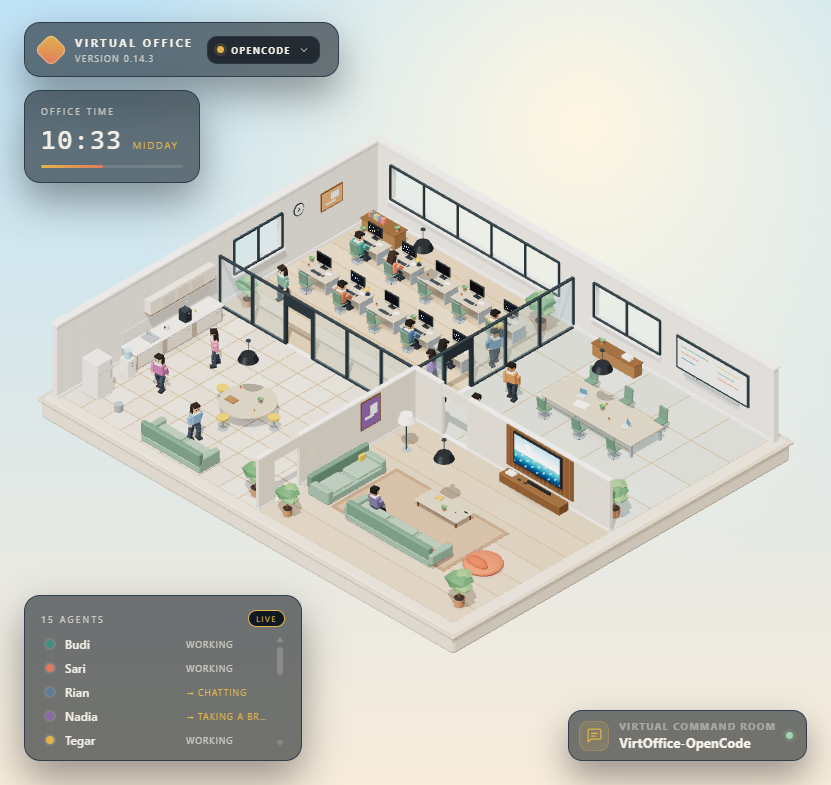

Open the chat popup and the diorama turns into a full control surface for the agent CLI you already run — **OpenCode**, **Claude Code**, or **Qoder** — with streaming replies, live tool calls, permission prompts, a file browser, a git client, real PTY terminals, and a QR code so you can watch the floor from your phone.

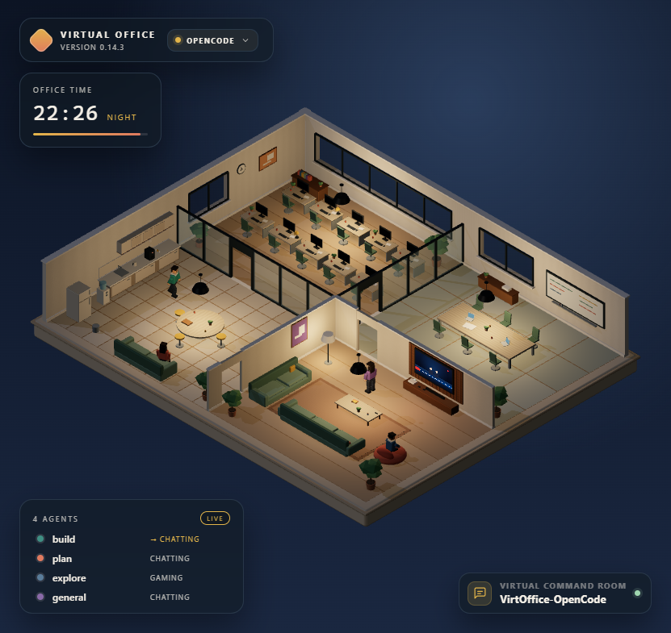

---

## Table of contents

- [Quick start](#quick-start)
- [Bring your own agent](#bring-your-own-agent)
- [The floor](#the-floor)
- [The popup: seven tabs](#the-popup-seven-tabs)
- [Office JS API](#office-js-api)
- [HTTP API](#http-api)
- [Configuration](#configuration)
- [Project layout](#project-layout)
- [Reshaping the floor plan](#reshaping-the-floor-plan)
- [Notes](#notes)

---

## Quick start

You need Node.js 20+ and at least one agent CLI that is already authenticated (OpenCode, Claude Code, or Qoder).

```bash
npm install
npm run dev       # bridge + Vite at http://127.0.0.1:5199
```

Then open <http://127.0.0.1:5199>, click the **Virtual Command Room** launcher in the bottom-right corner, and pick a project folder. The floor fills with that workspace's agents and the chat starts streaming.

```bash
npm run build     # typecheck + production bundle into dist/
npm start         # serve dist/ + API at http://127.0.0.1:4180
npm test          # 218 tests: layout, navigation, autopilot, day/night, agents, chat, presence, server, files, scm, terminal
```

`npm run dev` runs a Node server of its own (never bare `vite`). That one server serves the app, the API, and the agent event proxy, and its dev port is deliberately far from 5173 so a forgotten Vite process can't impersonate the bridge — the classic symptom being `/api/*` answering with HTML. Need another port?

```bash
npm run dev -- --port 5299
```

Two convenience launchers ship with the repo: `launch-dev.bat` / `launch-dev.sh` kills any older instance before starting a fresh one, and `stop-dev.bat` / `stop-dev.sh` shuts it down again.

## Bring your own agent

The pill next to the wordmark is the tool switcher. It lists six adapters; three are wired up today.

| Tool | Status | How it talks to the bridge |
| --- | --- | --- |
| **OpenCode** | available | spawns `opencode serve --hostname 127.0.0.1 --port 0`, or attaches to a server already listening on `127.0.0.1:4096` |
| **Claude Code** | available | `claude -p` with `--input-format/--output-format stream-json` and a stdio permission tool |
| **Qoder** | available | `qoder` CLI in `stream-json` mode, same event vocabulary, plus `--reasoning-effort` |
| Kilo, Phi, OpenClaw | not wired yet | listed with a **Soon** badge so the direction is visible, not selectable |

Switching is a two-step inline confirm inside the HUD — no browser dialogs — and the toast that follows carries **Undo**. The bridge you leave behind keeps running, so switching back is instant and your sessions survive the trip. The choice is remembered in `.virtoffice/tool.json` (gitignored).

```bash
VIRTOFFICE_TOOL=qoder npm run dev      # start on a specific adapter
VIRTOFFICE_TOOL=claude npm run dev     # or Claude Code
```

Whichever adapter is active, the same popup contract holds: streaming text, reasoning, tool calls, permission requests, agent questions, and stop. Providers and models are read from the CLI's own catalogue, and the bridge never forwards raw provider payloads to the browser — the client only ever sees model ids and names, never keys or options.

The app also maintains its own rules block: a delegation-pause paragraph is written between `<!-- virtoffice:rules:start/end -->` markers into `AGENTS.md` (OpenCode and Qoder) or `CLAUDE.md` (Claude), so delegated subagents hold still long enough for the office animation to notice them. The pause length is a Settings control.

## The floor

- **Workspace** — ten desks in two rows. Each monitor types out a random line of code while its agent works and fades to black when idle.
- **Meeting room** — six-seat table, laptops, whiteboard, glass wall. This is where a delegating agent and its delegated child sit together.
- **Pantry** — counter, coffee machine with animated steam, sink, fridge, water dispenser, round table with stools, tiled floor.
- **Lounge** — sofas, bean bags, a TV cycling eight slides with static between them, game console, rug, floor lamp.

Characters walk the aisle graph (weighted edges, Dijkstra), sit down at chairs and sofas, type, sip coffee, hold controllers, and look at screens. A day–night cycle drives the sun, the sky colour, pendant lamps that only light up after dark, and a TV that brightens the lounge at night.

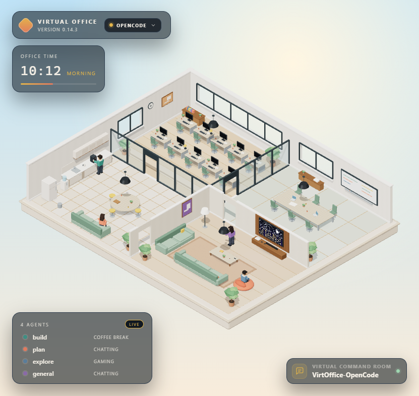

Headcount comes from the workspace roster, capped at 15 because that's how many chairs exist. Agents beyond the cap are still counted and named: the legend shows a `+N` badge and an **Off the floor** row. Above each employee's head, a bubble quotes what the session is really doing — `Thinking: …`, `Writing: …`, `Reading file: README.md` — and falls back to a typing-dot pill when there's nothing to quote.

The roster scales from 2 to 15 employees:

```
http://127.0.0.1:5199/?agents=2
http://127.0.0.1:5199/?agents=15
```

Without a workspace, the floor runs the 15-agent demo crew; with one, real agents replace them.

## The popup: seven tabs

A vertical icon rail on the left of the window splits it into seven pages. The last one you used is remembered, and `↑`/`↓` move between them while the rail has focus. The window floats, drags, and maximises to a full screen; the send button turns into a red stop square while a session is running.

### Agentic

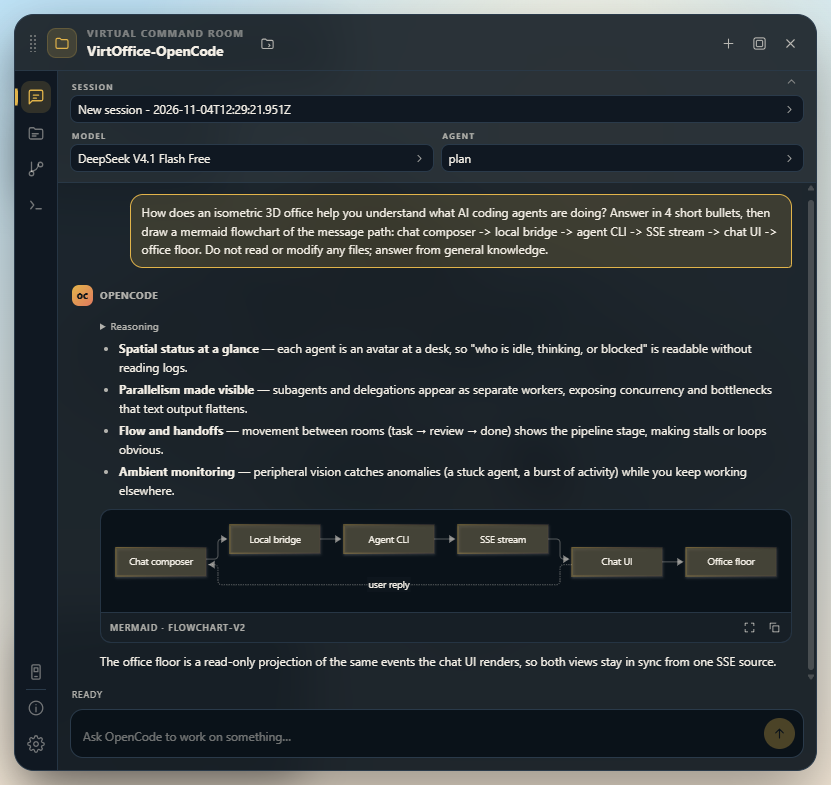

The chat itself. Answers go through a sanitising markdown renderer (headings, nested lists, task lists, tables, quotes, inline and fenced code) and any ` ```mermaid ` block is drawn as a real diagram — flowchart, sequence, gantt, pie, xychart and friends — with a zoom panel (`Esc` or backdrop click closes it) and a copy-code button. Because models don't know this panel exists, prompts that mention a diagram, chart, graph, or flowchart get one extra sentence appended asking for a ` ```mermaid ` block instead of ASCII art; that injected instruction is trimmed again when rendering, so your own bubble still shows the text you typed. Model percentage syntax (`"Backend" : 40%`) is repaired before drawing, and a diagram that still fails to parse shows a short message with the original source behind a **View code** toggle.

Mid-run the same page shows the elapsed timer, the phase chip, and the red stop square:

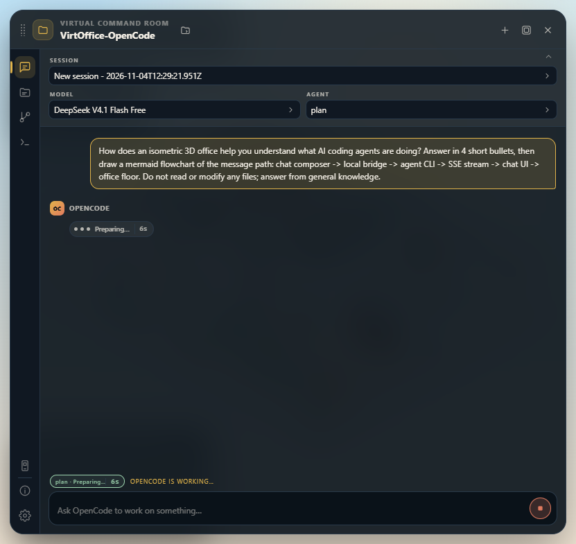

Tool calls that need approval raise an **Allow / Always allow / Deny** card inside the thread; agent questions raise answer chips. The session, model and agent pickers sit above the thread in a collapsible two-row panel, both searchable.

### File List

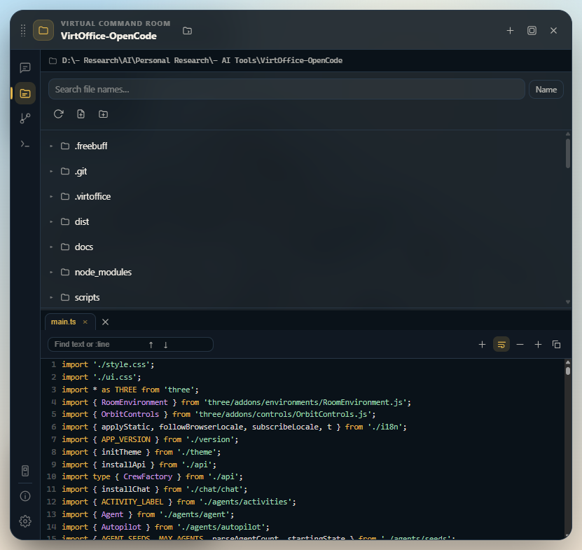

The active workspace as a tree, with the full workspace path printed at the top. Folders load lazily, files preview on click with line numbers and syntax highlighting, and rows show sizes. Hover a row to rename or delete — deletion confirms itself inside the panel, never with a browser dialog. There are new-file and new-folder buttons, a reload button, and a search that matches names or file contents (with line numbers and snippets; opening a hit jumps to that line). The `＋` button in the preview toolbar writes `@path/to/file.ts` into the composer and returns you to Agentic, so the file you're looking at becomes the file the agent is working on.

Rows also carry a clipboard: right-click gives **Copy** / **Cut** / **Paste into …**, and `Ctrl+C`, `Ctrl+X`, `Ctrl+V` do the same while this page is showing (inputs and text selections keep their normal shortcuts). The marked item sits in a chip under the toolbar, a cut row goes dim, and pasting into a folder that already holds it just says so instead of touching the disk. Any row can be dragged onto a folder to move it — hold `Ctrl` while dropping to copy instead, and drop on empty list space to target the workspace root. The target folder is highlighted during the drag. Copies pasted where the name is taken come out as `a (2).ts` / `docs (2)` rather than failing.

The preview window docks below the list or beside it (**Settings → Preview → Preview window position**); side-by-side only applies when maximised. The divider between list and preview drags to any split between 20–80%, the ratio is stored locally, and **Restore defaults** puts it back. The same rules apply to diffs in Source Control.

Paths travel relative to the workspace root and the bridge rejects `..`, absolute paths, drive letters, and separator characters — see `server/files.mjs`.

### Source Control

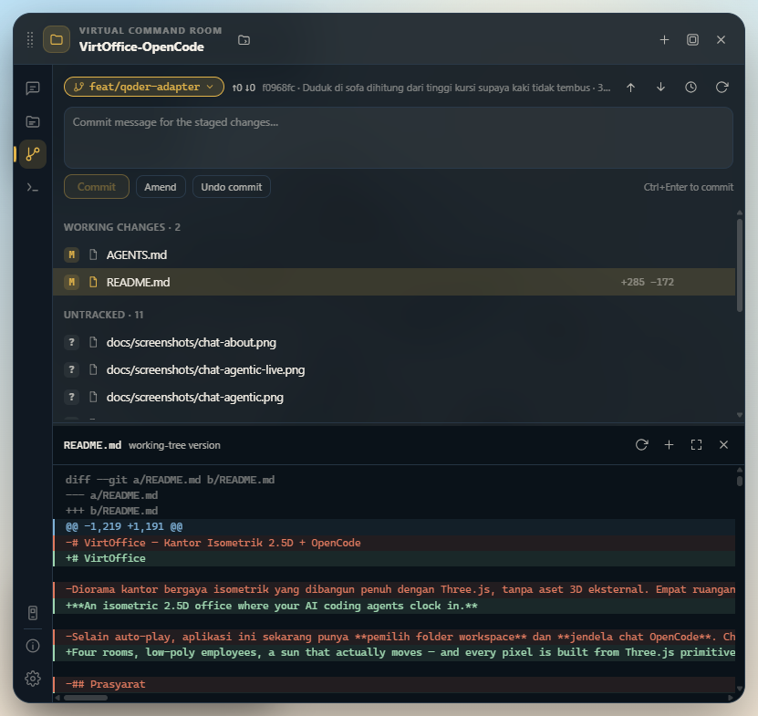

A git client with the same affordances as VS Code's, inside the window. The branch chip opens a picker listing local branches (with `↑n ↓m` against upstream) and remotes, takes a new name to create-and-switch, switches on click, and deletes inactive branches after an inline confirm. Below it, the composer enables `Commit (n)` only when something is staged, `Amend` overwrites the last commit, `Ctrl+Enter` sends it, and **Undo commit** soft-resets `HEAD~1` — the contents land back in *Staged*, nothing is lost.

Changes group into *Staged*, *Working changes*, and *Untracked*, each row carrying its porcelain letter (`M`/`A`/`D`/`R`/`?`) plus `+added −removed` counts. Hover actions stage or unstage a file (renames move as a pair so the origin doesn't ghost), and the trash icon discards. Discarding always asks first, and untracked files are removed from disk. The header arrows push and pull, the clock opens the last 30 commits, and clicking a row opens a per-file diff with a toggle between the index and working version. Everything calls real git through `server/scm.mjs`, so the page always matches `git status` in a terminal.

### Terminal

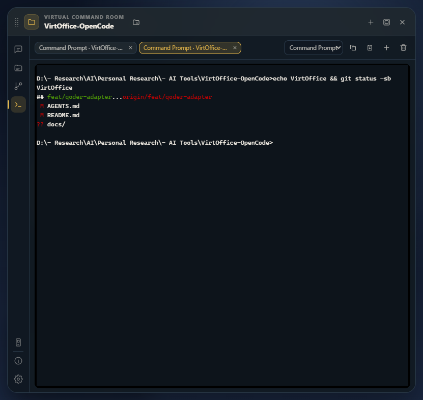

Multi-tab shells (cmd, PowerShell, PowerShell 7 — whatever your machine has) spawned as **real PTYs** through node-pty, ConPTY on Windows, rooted in the active workspace. `＋` opens a tab with the shell from the dropdown, `×` closes it, up to six live at once, and they die with the dev server. xterm.js is only loaded when this tab opens, so the other pages don't pay for the bundle. Grid size is pushed to the PTY on every fit, so full-screen apps see the real width and height.

Because it's a PTY, echo, line editing, arrow-key history and `Ctrl+C` are handled by the shell — `vim`, `htop`, and anything that asks for a terminal size behaves. `Ctrl+C` is only hijacked for copy when text is selected. Copy works on selection or the Copy button; paste uses `navigator.clipboard`, and if the browser refuses clipboard access an inline paste pad appears — paste there, `Enter`, and the text lands in the shell, running only on the next `Enter`. Multi-line pastes are split into one command per line.

On Windows each shell gets its PATH from the registry (`HKLM\...\Session Manager\Environment` plus `HKCU\Environment`, `%VAR%` expanded, duplicates dropped, MSYS variables like `MSYSTEM` removed) rather than inheriting the dev server's environment — so a cmd tab can't suddenly run Git Bash coreutils. If `reg query` fails, the inherited PATH is used and the tab tooltip says which. On Linux and macOS the environment is inherited as-is, plus `TERM=xterm-256color`.

### Mobile

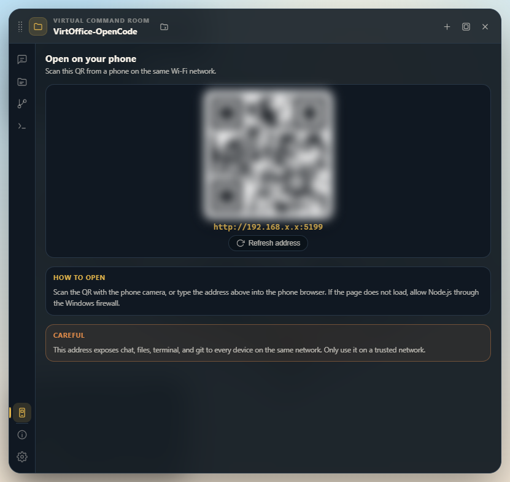

Same app, other device. The bridge binds to `0.0.0.0` and scores the machine's network adapters, preferring a private Wi-Fi address over virtual ones (WSL/Hyper-V switches are demoted), then renders a QR code plus the plain URL and any alternative addresses. Open it on a phone on the same network and the office is there — with a warning card explaining that the dev bridge has no authentication, so this is for your own LAN.

### About and Settings

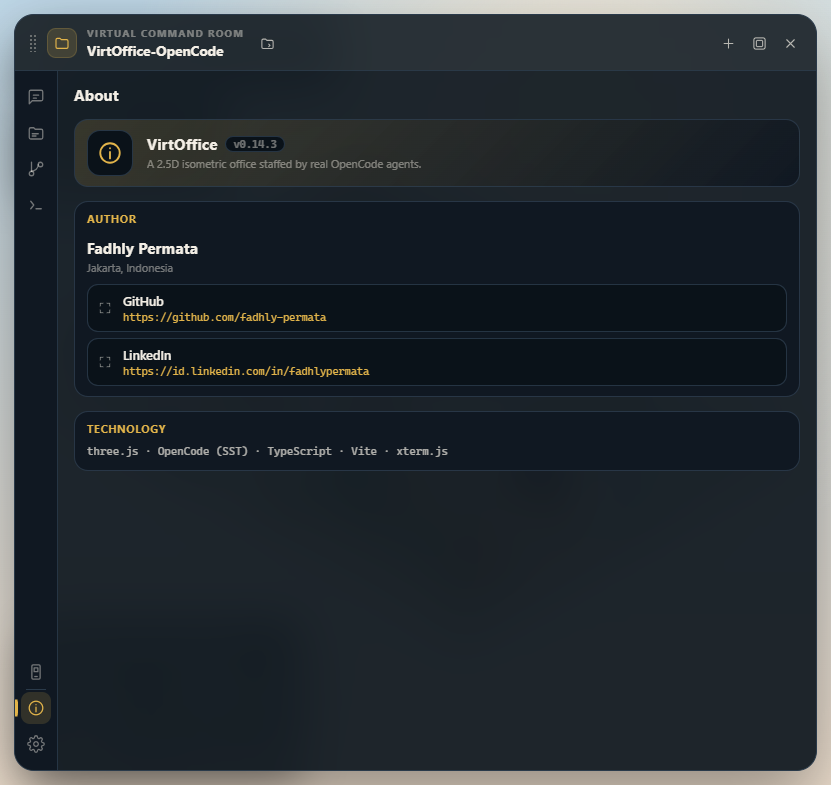

About is deliberately short: app name and version (read from `package.json` through `src/version.ts`, so the number lives in exactly one place), a one-line tagline, the author card with GitHub and LinkedIn links opening in a new tab with `rel="noopener noreferrer"`, and a single technology line.

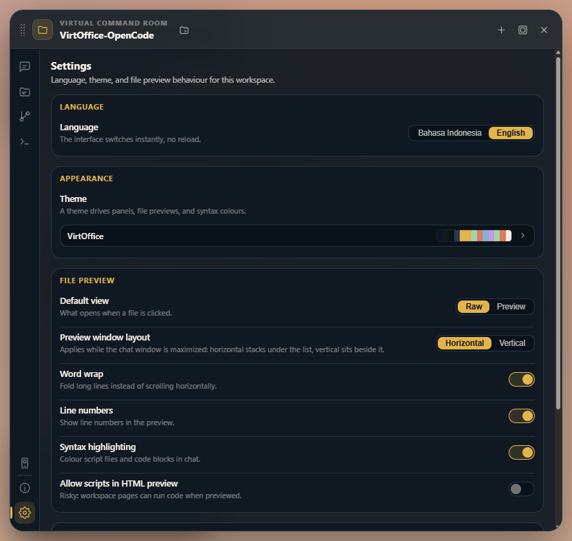

Settings holds the UI language, one of 24 colour themes, preview behaviour and window position, the agent delegation pause, and a **Restore defaults** escape hatch.

## Office JS API

`window.virtOffice` is a global control surface for the floor — useful for demos, screen recordings, and driving the office from your own tooling.

```js
virtOffice.agents();
// [{ id: 'build', name: 'build', activity: 'working', state: 'settled', signal: 'writing', bubble: 'Thinking: …', ... }]

virtOffice.setCrew([{ id: 'build', label: 'build' }]);   // rebuild the floor from an agent list
virtOffice.applyPresence([                                // seat people by session activity
  { agent: 'build', role: 'delegating', sessionID: 'ses_1' },
  { agent: 'explore', role: 'delegated', sessionID: 'ses_2' },
], { ses_1: 'Running a subagent: find the README' });    // second argument: bubble text per session
virtOffice.setActivity('build', 'gaming');               // true when it worked
virtOffice.setAgentSignal('build', 'tool', 'Thinking: …'); // pill / bubble overhead
virtOffice.release('build');                             // back to autopilot (also clears the pill)
virtOffice.setTimeOfDay(19.5);
virtOffice.setTimeScale(0);                              // freeze time
```

Activities: `working`, `meeting`, `coffee`, `gaming`, `tv`, `idle`.
Pill signals: `waiting`, `thinking`, `tool`, `writing`.
Presence roles: `working` (a desk), `delegating` + `delegated` (the meeting room), `idle` (free to roam).

Behaviour worth knowing:

- `applyPresence` only moves employees whose role actually changed, so nobody re-walks the floor for no reason.
- `setActivity` finds a free spot for that activity, pins the agent, and sends them there. They stay until `release`.
- A released agent gets rescheduled by the autopilot on the next tick.
- Every arrival emits an event:

```js
document.addEventListener('virtoffice:agent', (event) => {
  console.log(event.detail); // { id, name, activity, spot, room }
});
```

## HTTP API

Everything the popup does goes through these routes on the same origin.

| Method | Path | Purpose |
| --- | --- | --- |
| GET | `/api/health` | server + agent tool status |
| GET | `/api/lan` | LAN address, port, adapter candidates, reachability |
| GET/POST | `/api/workspace` | read / open the active workspace |
| GET | `/api/workspace/browse?path=` | folder contents (no files, dot-dirs, or `node_modules`) |
| GET | `/api/chat/tree?path=` | one level of the workspace tree (folders first) |
| GET | `/api/chat/file?path=` | file text (256 kB cap, flagged when truncated or binary) |
| GET | `/api/chat/raw/…` | raw file bytes for preview (images, HTML) |
| GET | `/api/chat/search?q=&mode=name\|content` | search names or file contents |
| POST | `/api/chat/files` | create file/folder (`path`, `kind`) |
| POST | `/api/chat/files/rename` | rename / move (`from`, `to`) |
| POST | `/api/chat/files/copy` | copy file/folder recursively (`from`, `to`, `unique`) |
| POST | `/api/chat/files/delete` | delete file or folder recursively |
| GET | `/api/chat/scm/status` | branch, upstream, last commit, change list |
| GET | `/api/chat/scm/diff?path=&staged=1` | one-file diff; untracked renders as all-added |
| POST | `/api/chat/scm/stage` | stage/unstage paths (renames as pairs) |
| POST | `/api/chat/scm/stage/all` | stage or unstage everything |
| POST | `/api/chat/scm/commit` | commit message over stdin (`message`, `amend`) |
| POST | `/api/chat/scm/commit/undo` | `reset --soft HEAD~1`, down to an unborn repo |
| POST | `/api/chat/scm/discard` | per-file rollback; untracked files are deleted |
| GET | `/api/chat/scm/branches` | local branches with ahead/behind, plus remotes |
| POST | `/api/chat/scm/branch/switch` | `git switch` (remote branches become local) |
| POST | `/api/chat/scm/branch/create` | `git switch -c` (`name`, `checkout`) |
| POST | `/api/chat/scm/branch/delete` | `git branch -d`; the active branch is refused |
| GET | `/api/chat/scm/history?limit=` | last commits (max 100) |
| POST | `/api/chat/scm/push` / `pull` | sync with upstream; 409 without a remote |
| GET | `/api/chat/terminal/shells` | shells available on this machine |
| GET | `/api/chat/terminal` | live terminal sessions |
| POST | `/api/chat/terminal` | open a shell (`shell`, `cwd` — forced inside the workspace) |
| GET | `/api/chat/terminal/events?id=` | SSE output for one terminal |
| POST | `/api/chat/terminal/input` | keystrokes into a shell's stdin |
| POST | `/api/chat/terminal/resize` | PTY size (`cols`, `rows`; outside 2–500 × 1–300 → 400) |
| POST | `/api/chat/terminal/close` | kill a shell and its children |
| GET/POST | `/api/chat/tool` | read the adapter catalogue / switch adapters (`force`) |
| POST | `/api/chat/rules` | rewrite the delegation-pause rules block |
| GET | `/api/chat/bootstrap` | workspace, models, agents, `roster`, sessions |
| GET | `/api/chat/status` | `sessionID → status` map for the floor |
| GET | `/api/chat/activity?ids=a,b` | last message tail per session, for the bubbles |
| POST | `/api/chat/sessions` | create a session |
| GET | `/api/chat/sessions/:id` | message history + status + pending permissions |
| POST | `/api/chat/sessions/:id/messages` | send a prompt |
| POST | `/api/chat/sessions/:id/abort` | stop a response |
| GET | `/api/chat/events` | SSE stream of agent events |
| POST | `/api/chat/permissions/:id` | answer a permission (`once`/`always`/`reject`) |
| POST | `/api/chat/questions/:id` | answer an agent question |

## Configuration

| Variable | Default | Meaning |
| --- | --- | --- |
| `VIRTOFFICE_TOOL` | stored preference | start on `opencode`, `claude`, or `qoder` |
| `VIRTOFFICE_CLAUDE_BIN` | `claude` on PATH | Claude Code executable |
| `VIRTOFFICE_CLAUDE_EFFORT` | flag omitted | `--effort` for Claude Code: `low`, `medium`, `high`, `xhigh`, `max` |
| `VIRTOFFICE_QODER_BIN` | `qoder` on PATH | Qoder CLI executable (Windows goes through a dispatcher) |
| `VIRTOFFICE_QODER_EFFORT` | flag omitted | `--reasoning-effort` for Qoder, same five levels |
| `VIRTOFFICE_OPENCODE_URL` | probe `127.0.0.1:4096` | attach to an existing OpenCode server instead of spawning one |
| `PORT` / `HOST` | `5199` dev, `4180` prod / `0.0.0.0` | listen address |

Workspace and recents live in `.virtoffice/workspace.json`; the chosen adapter in `.virtoffice/tool.json`. Both are gitignored. Every request to the underlying agent tool carries the active folder as `directory`, so config, `AGENTS.md`, and tool behaviour follow the project you opened.

## Project layout

```
server/
  index.mjs         HTTP server, API routing, SSE proxy, Vite middleware / static dist
  http.mjs          JSON body, error, and response helpers
  opencode.mjs      `opencode serve` process, model/agent/session catalogue, event stream
  claude.mjs        Claude Code CLI bridge (stream-json over stdio)
  qoder.mjs         Qoder CLI bridge (stream-json, reasoning effort, Windows dispatcher)
  workspace.mjs     folder validation, directory browse, workspace + recents
  files.mjs         file tree, read/write/delete, search — locked inside the workspace
  scm.mjs           git status, diff, stage, commit, branch, history, push/pull
  terminal.mjs      node-pty shells (ConPTY on Windows), resize, 6-session cap, SSE per terminal
  rules.mjs         delegation-pause rules block written into AGENTS.md / CLAUDE.md
  network.mjs       LAN adapter scoring for the Mobile tab
src/
  chat/
    chat.ts         popup controller, SSE streaming, sessions, permissions, composer, rail
    toolswitch.ts   HUD tool pill: menu, inline confirm, switching state, undo toast
    client.ts       fetch wrapper for /api/chat
    files.ts        File List page: tree, preview, CRUD, search
    scm.ts          Source Control page: status, diff, commit, branches, history
    settings.ts     Settings page: language, theme, preview, agent pause
    about.ts        About page: identity, author, links
    mobile.ts       Mobile page: QR code, LAN URL, adapter alternatives
    terminal.ts     Terminal page: xterm.js tabs, paste pad, resize, SSE
    markdown.ts     markdown renderer + mermaid diagrams and zoom panel
    highlight.ts    syntax highlighting for previews and diffs
    select.ts       searchable dropdown used by session/model/agent pickers
    split.ts        draggable divider between list and preview
    context-menu.ts in-panel context actions (no browser dialogs)
    prefs.ts        local preference storage
    state.ts        event reducer + formatting helpers
    folder.ts       workspace folder picker modal
    dom.ts          element helpers + SVG icons
    types.ts        chat payload types
  i18n/             Indonesian and English strings, 17 namespaces, browser-locale detection
  theme/            24 colour themes as CSS custom properties
  core/
    dayNight.ts     simulated clock, daylight factor, sky colour
    math.ts         clamp, smoothstep, angle damping
    palette.ts      colour palette + material cache
    textures.ts     procedural textures (wood, fabric, plaster, lamp halo, contact shadow, TV slides)
    textBubble.ts   speech bubble above an employee (canvas 2D → sprite)
    typing.ts       self-typing code lines for the monitors
    storage.ts      small local-storage helper
  world/
    layout.ts       four-room floor plan, spot list, navigation nodes and edges
    nav.ts          weighted graph + Dijkstra
    kit.ts          geometry helpers (box, rounded box, cylinder, sphere)
    office.ts       the whole diorama, lighting, ambient animation
  agents/
    character.ts    low-poly rig (two-segment legs, arms, mug, gamepad)
    agent.ts        state machine, path following, procedural poses
    autopilot.ts    weighted activity scheduler
    activities.ts   activity labels, durations, time-of-day weights
    seeds.ts        15-person demo roster, agent-count bounds, unique starting spots
  office/
    presence.ts     agent list + session status → role per employee
  api.ts            the window.virtOffice bridge
  version.ts        app version, single source of truth
  main.ts           renderer, camera, HUD, loop, popup mounting
tests/              vitest: scene, chat reducer, server helpers
```

## Reshaping the floor plan

Every coordinate lives in `src/world/layout.ts`:

- `ROOMS` — the 13 × 10.5 quadrant split.
- `PARTITIONS` — interior walls and their door gaps; a test proves no navigation edge crosses a wall outside a doorway.
- `SPOTS` — activity points (`activity`, position, facing, sitting height).
- `AISLES` + `EDGES` — the movement graph. Every spot automatically gets an `s:<id>` node.

Add a spot, wire it to the nearest aisle with an edge, then run `npm test` — the connectivity and doorway tests catch mistakes for you.

## Notes

- No model or texture files anywhere: all geometry comes from primitives and `RoundedBoxGeometry`.
- Shadows use one directional light with a 2048 shadow map; room lamps are `PointLight`s that only switch on after dark.
- Glass partitions are transparent without `depthWrite`, so the interior stays readable from the isometric camera.
- Environment-based lighting (IBL) handles metal and glass reflections; procedural wood and fabric textures, plank and tile floors with tone variation, and contact shadows under furniture do the rest.
- The UI ships in Indonesian and English (browser locale is detected on first load) and 24 themes; labels live in `src/i18n/ns/`, activity wording in `src/agents/activities.ts`.
